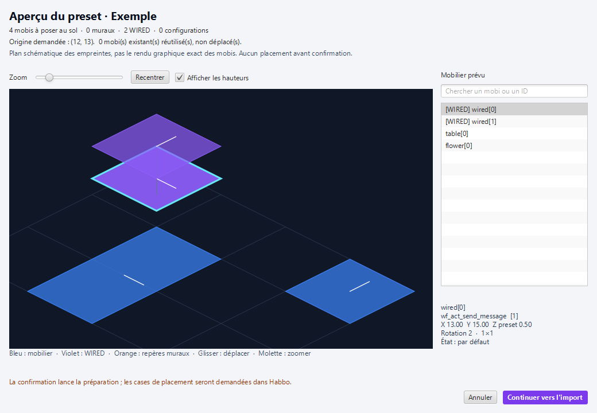

<p align="center"></p>

<p align="center">
<a href="https://github.com/Tear1338/G-Presets/releases"></a>
<a href="https://github.com/Tear1338/G-Presets/actions/workflows/release.yml"></a>

<a href="https://github.com/sirjonasxx/G-Presets"></a>
</p>

<h1 align="center">G-Presets · édition Darkz</h1>
<p align="center"><strong>Exportez une création. Explorez son aperçu. Retrouvez-la dans une autre salle.</strong><br>Une version modifiée de G-Presets, maintenue par <a href="https://github.com/Tear1338">Tear1338 / Darkz</a>.</p>
<p align="center"><a href="https://github.com/Tear1338/G-Presets/releases"><strong>Télécharger le .jar</strong></a> · <a href="#installation">Installation</a> · <a href="#un-aperçu-avant-de-construire">Aperçu</a> · <a href="COMPATIBILITE.md">Compatibilité WIRED</a> · <a href="https://github.com/Tear1338/G-Presets/issues">Signaler un problème</a></p>

> **Crédits.** Le projet original est [G-Presets par sirjonasxx](https://github.com/sirjonasxx/G-Presets). Cette édition est modifiée par **1desirable1337** (Tear1338 / Darkz) à partir de la version 1.3.7 modifiée fournie. Elle est indépendante du projet original et de Habbo/Sulake. [Attributions détaillées](ATTRIBUTION.md).

## Construisez une fois, réutilisez vos idées

G-Presets est une extension **G-Earth** pour exporter et importer des créations Habbo : mobilier, positions, états et configurations WIRED. Cette édition ajoute la prise en charge de formats WIRED récents et un aperçu interactif avant le placement.

| Votre création | Ce que propose cette édition |
| :--- | :--- |
| Une salle ou une zone | Export du sol, du mobilier mural et du contexte disponible |
| Un montage WIRED | Six familles : déclencheurs, effets, conditions, add-ons, sélecteurs et variables |
| Des variables et dépendances | Références, ordre de résolution, contextes modernes et valeurs prises en charge |
| Des configurations avancées | Contrats, préférences des coffres, réseaux existants, labels et régions |
| Un import à préparer | Plan isométrique, recherche, détails et confirmation avant placement |

## Un aperçu avant de construire

<p align="center"></p>
<p align="center"><sub>Capture de l'interface réelle avec un preset de démonstration. Les formes représentent les empreintes des objets.</sub></p>

Ouvrez **Aperçu du preset**, ou tapez `:preview` / `:pp`, pour inspecter le preset sélectionné :

- **Explorez** le plan : zoom, déplacement et recentrage.
- **Inspectez** un objet : classe, identifiant, coordonnées, hauteur, état et orientation.
- **Préparez** les remplacements : les classes remplacées sont reflétées dans le plan.
- **Confirmez** avec **Continuer vers l'import**, ou annulez avant toute préparation ou placement.

L'option **Aperçu avant import (:ip)** est activée par défaut. L'origine de `:ip x,y` est conservée. Une confirmation devenue obsolète après un changement de salle, de preset ou d'options est rejetée.

Il s'agit d'un **plan schématique**, avec repères 1 × 1 pour les dimensions inconnues et position murale indicative. Les images originales des mobis ne sont pas rendues.

## Installation

1. Installez **Java 17 ou plus récent** et une version de **G-Earth** compatible avec votre client Habbo.
2. Ouvrez [les releases de cette édition](https://github.com/Tear1338/G-Presets/releases) et téléchargez **`GPresets-<version>.jar`**. Les versions `rc` sont des préversions.
3. Chargez ce `.jar` dans G-Earth. Conservez une sauvegarde de vos anciens presets.
4. Entrez dans la salle source après le démarrage de l'extension. Chargez les données de mobilier, le catalogue et l'inventaire nécessaires.
5. Exportez votre création, sélectionnez le preset, consultez son aperçu puis lancez l'import.

Le catalogue de noms de paquets doit correspondre au client utilisé. Le mobilier doit être disponible dans l'inventaire, dans la salle ou dans le BC selon la source choisie. L'import requiert les droits et les stacktiles adaptés au montage.

### Les commandes utiles

| Commande | Action |
| :--- | :--- |
| `:ep` | Exporter une zone sélectionnée |
| `:ep all` | Exporter la salle entière |
| `:preview` ou `:pp` | Ouvrir l'aperçu du preset sélectionné |
| `:ip` | Prévisualiser puis importer |
| `:ip 0,5` | Importer avec une origine définie |
| `:a` | Interrompre l'opération en cours |

Pour conserver les données disponibles, laissez décochées les options **Do not export wired**, **Do not export Furni Variables** et **Do not export wall items**. Les préférences déjà enregistrées restent respectées.

## Compatibilité et validation

La version **1.4.0** dispose de **1 203 assertions de régression**, de fixtures binaires pour **188 codes de formulaires** et d'un test de chargement de l'interface JavaFX. L'inventaire de référence contient **284 classes liées aux WIRED**, dont **207 classes des six familles de configuration**.

Ces chiffres vérifient le transport des données et les comportements couverts par les tests. **Aucun cycle complet export/import ni scénario WIRED en jeu n'a encore été validé.** Les prototypes `wf_test_26secret1` et `wf_test_26secret2` ont un comportement configurable inconnu. La version reste donc une **release candidate**.

Référence étudiée : client Flash français `WIN63-202610201032-107964540`, du 20 octobre 2026, catalogue du 26 octobre 2026. Habbo peut faire évoluer ses formats.

- [Détail de compatibilité](COMPATIBILITE.md) et [inventaire WIRED](COUVERTURE-WIRED.csv)
- [Guide technique et limites](README.fr.md)
- [Rapports de validation de la rc2](validation/1.4.0-rc2/)
- [Changements de cette édition](CHANGELOG.md)

Un import interrompu peut laisser des mobis déjà placés : Habbo ne fournit pas de transaction globale. Les coffres conservent leurs préférences prises en charge, sans copier leur contenu ou leur solde ; les liens WIRED utilisent un réseau existant accessible.

## À découvrir : HabbOne

<a href="https://www.habbone.fr/habbos"></a>

Entre deux créations WIRED, rendez-vous sur **[HabbOne · Habbos](https://www.habbone.fr/habbos)**. Un projet de la communauté à découvrir et à partager avec vos amis Habbo.

## Reconstruire et publier

Le build de cette édition utilise **Python 3 et un JDK 17+**. Les sources applicatives sont toutes recompilées ; le runtime récupéré et les dépendances d'interface sont conservés dans `lib/`.

```powershell
python scripts/build.py --java-home 'C:/Program Files/Java/jdk-21.0.10' --ui-smoke
python scripts/package.py
```

Chaque changement de version poussé sur `master` déclenche le build et les tests sous Windows, puis crée une release avec **le nouveau `.jar`, l'archive complète, les sommes SHA-256 et le rapport de build**. Les versions candidates sont publiées comme préversions. Le workflow peut aussi être relancé manuellement. Voir [RELEASING.md](RELEASING.md).

<p align="center"><sub>Original par <a href="https://github.com/sirjonasxx/G-Presets">sirjonasxx</a> · Modifié par <a href="https://github.com/Tear1338">Tear1338 / Darkz</a> · Créé pour les passionnés de constructions Habbo</sub></p>


## Nouveautés 1.5.0

- **Share preset** : nom, description et image de la vue actuelle dans un fichier JSON compatible avec les presets existants. Attendez le chargement des images avant de sauvegarder. L'original est conservé.
- **Avant import** : le résumé apparaît dans l'aperçu. **Check availability** détaille les objets au sol et au mur, les variantes d'affiches, l'inventaire et les offres BC. Une offre BC ne garantit ni le quota ni les droits de placement.
- **Check WIRED** : format, doublons, dépendances de variables et catalogue de messages G-Earth. Les références externes sont signalées ; elles peuvent être intentionnelles et doivent être vérifiées dans la salle de destination.
- **Après import** : fenêtre avec positions/états observés, objets non observés et confirmations de configurations. **Save report** exporte un JSON sans écraser un fichier existant. Les réponses serveur tardives peuvent modifier l'état réel après cette photographie.
- **Aperçu** : **Rotate view**, **Max height** et **Selected item only** aident à examiner les empilements. Zoom, panoramique et recentrage restent disponibles. Les images proviennent de l'imager public HabboAssets avec orientation et état demandés.

Le rendu des images reste approximatif (ancrages, variantes absentes, murs et animations). La rotation de l'aperçu ne modifie pas le preset ni les coordonnées d'import. Les images indisponibles restent représentées par leur empreinte. Les contrôles locaux et confirmations de sauvegarde ne valident pas les comportements WIRED en jeu ; un cycle réel export/import reste nécessaire.
