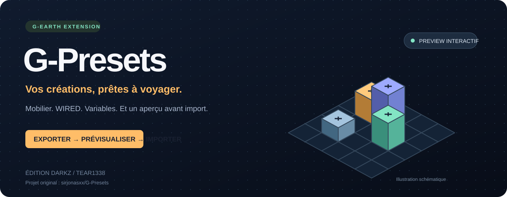
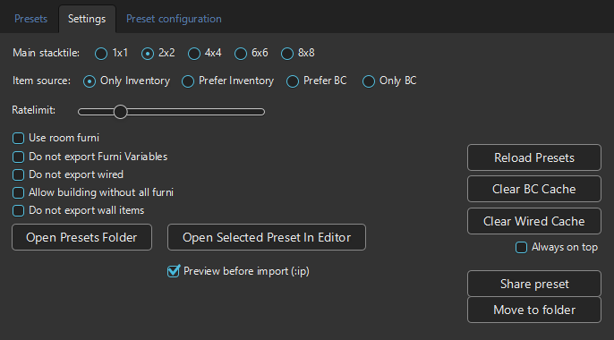

<p align="center"></p>

<p align="center">
<a href="https://github.com/Tear1338/G-Presets/releases/latest"></a>
<a href="https://github.com/Tear1338/G-Presets/actions/workflows/release.yml"></a>

<a href="https://github.com/sirjonasxx/G-Presets"></a>
</p>

<h1 align="center">G-Presets · édition 1desirable1337</h1>
<p align="center"><strong>Exportez vos constructions. Prévisualisez les mobis. Partagez vos presets.</strong><br>Extension G-Earth modifiée par <strong>1desirable1337</strong> — <a href="https://github.com/Tear1338">Tear1338 / Darkz</a>.</p>
<p align="center"><a href="https://github.com/Tear1338/G-Presets/releases/download/v1.6.1/GPresets-1.6.1.jar"><strong>Télécharger GPresets-1.6.1.jar</strong></a> · <a href="#installation">Installation</a> · <a href="#aperçu-et-images-des-mobis">Aperçu</a> · <a href="#partager-et-organiser-ses-presets">Partage</a> · <a href="https://www.habbone.fr/habbos">HabbOne</a></p>

> **Auteurs : sirjonasxx & 1desirable1337.** Cette édition est une version modifiée de [sirjonasxx/G-Presets](https://github.com/sirjonasxx/G-Presets), préparée à partir de la version 1.3.7 modifiée fournie. Elle est indépendante du projet original et de Habbo/Sulake. [Crédits et attributions](ATTRIBUTION.md).

## Correctif d'import 1.6.1

- **Prefer BC** utilise le Builders Club en priorité, puis l'inventaire pour les mobis sans offre BC. La même règle s'applique au sol et au mur ; les offres du catalogue BC sont aussi prises en compte avant l'import.
- **Allow building without all furni** termine les étapes restantes avec les mobis disponibles. Les WIRED dont une sélection, un instantané ou une variable requise manque sont ignorés et détaillés dans le rapport ; les autres configurations continuent.
- Les propriétés valides d'un mobi restent importées lorsque seule une valeur dépend d'un élément absent. Le rapport conserve les quantités demandées et affiche **Import finished with omissions**. En mode strict, un mobi requis manquant bloque toujours l'import.
- Les erreurs de transport, refus de sauvegarde et confirmations manquantes restent des erreurs : cette option ne transforme pas un import non confirmé en réussite. Le rapport inclut désormais la raison exacte de l'arrêt.

## Ce que propose la version 1.6.1

| Fonction | Dans cette édition |
| :--- | :--- |
| Export et import | Mobilier au sol et au mur, positions, orientations, états et données prises en charge |
| WIRED modernes | Six familles : déclencheurs, effets, conditions, add-ons, sélecteurs et variables ; configurations auxiliaires prises en charge |
| Aperçu interactif | Images des mobis, zoom, déplacement, rotation de vue, hauteurs et inspection d'un objet |
| Images plus rapides | Préchargement à la sélection, quatre téléchargements simultanés et cache partagé entre aperçu et partage |
| Contrôles avant import | Disponibilité du mobilier, diagnostic WIRED et vérification des messages connus par G-Earth |
| Suivi de l'import | Progression par phase, pause/reprise entre les opérations et rapport final exportable |
| Organisation et partage | Recherche, classement alphabétique, dossiers sur un niveau et JSON avec nom, description et image |
| Nouveaux outils | Annulation des placements identifiés, comparaison, historique local, remplacements et placement assisté |
| Confidentialité | Choix des métadonnées et contrôle du JSON exact avant le partage |
| Lisibilité | Thème sombre de G-Earth : fonds anthracite, champs foncés, textes clairs et onglets bleus |

Aucun preset personnel n'est fourni avec la distribution. Les changements détaillés sont dans le [journal des versions](CHANGELOG.md).

## Une interface assortie à G-Earth

La 1.6.1 conserve le thème sombre de G-Earth : panneaux gris anthracite, boutons et champs foncés, textes clairs, onglets bleus et accents cyan. Le même style s'applique à l'aperçu, au partage et aux rapports.

<p align="center"></p>

## Installation

1. Utilisez **Windows 64 bits**, **Java 17 ou plus récent** — Java 21 convient — et G-Earth. Cette édition vise notamment **G-Earth 1.5.4-beta-29**.
2. Téléchargez [**GPresets-1.6.1.jar**](https://github.com/Tear1338/G-Presets/releases/download/v1.6.1/GPresets-1.6.1.jar), puis installez-le dans G-Earth. Pour une mise à jour, fermez l'ancienne instance de l'extension avant de lancer la nouvelle.
3. Connectez Habbo via G-Earth, puis entrez dans la salle après le démarrage de l'extension pour que les données de la salle soient capturées.
4. Chargez les données nécessaires avec **Load Inventory** et **Load BC Catalog**, selon la source de mobilier choisie. Vérifiez les indicateurs de préparation de l'extension.
5. Exportez une construction, sélectionnez le preset, ouvrez **Preview preset**, puis consultez les vérifications avant de confirmer l'import.

Le placement dépend du mobilier disponible, des droits dans la salle et des stacktiles nécessaires. Le catalogue de messages G-Earth doit correspondre à votre client Habbo. Conservez une copie de vos presets avant de modifier leurs fichiers.

L'[archive complète 1.6.1](https://github.com/Tear1338/G-Presets/releases/download/v1.6.1/GPresets-1.6.1-complet.zip) contient aussi les sources et dépendances. Les sommes SHA-256 et le rapport de compilation sont disponibles dans la [release](https://github.com/Tear1338/G-Presets/releases/tag/v1.6.1).

## Aperçu et images des mobis

<p align="center"></p>
<p align="center"><sub>Capture de démonstration de l'interface 1.6.1 : les empreintes sont visibles pendant le chargement des images. Aucun preset personnel n'est utilisé.</sub></p>

Ouvrez **Preview preset**, ou utilisez `:preview` / `:pp`, pour examiner le preset sélectionné.

- **Zoom**, molette et glisser-déplacer pour parcourir la construction ; **Reset view** pour recentrer.
- **Rotate view** pour changer de point de vue ; **Show heights** et **Max height** pour examiner les empilements.
- **Selected item only** pour isoler le mobi sélectionné. La liste permet de rechercher un nom, une classe ou un identifiant.
- Les détails affichent les coordonnées, l'orientation, l'état et les décalages muraux disponibles.
- **Furniture images** active les images fournies par [HabboAssets](https://www.habboassets.com/). Une image indisponible reste représentée par son empreinte.

L'option **Preview before import (:ip)** est activée par défaut. **Continue to import** confirme la préparation de l'import ; **Cancel** ferme l'aperçu sans placer de mobilier. L'origine de `:ip x,y` est proposée dans l'aperçu ; **Choose origin here**, **X** et **Y** permettent de la modifier ou de revenir au choix en jeu. Un changement de salle, de preset ou d'options invalide l'ancienne confirmation.

### Pourquoi le chargement est plus rapide

Les images commencent à se charger dès la sélection d'un preset. L'aperçu et **Share preset** utilisent le même cache, sans télécharger plusieurs fois la même variante d'un mobi. Quatre téléchargements peuvent avancer en parallèle ; la pause de 1,1 seconde entre chaque image a été supprimée.

Les images déjà décodées apparaissent dès la première vue. Un cache sur disque, valable sept jours, évite de tout retélécharger après redémarrage. Le compteur **Images** indique les variantes chargées et indisponibles. Le premier chargement dépend encore du réseau et du serveur d'images ; ses demandes de temporisation sont respectées.

Le rendu reste approximatif pour certains ancrages d'images, murs, variantes et animations. La rotation de la vue ne transforme pas le preset ni ses coordonnées d'import.

## Vérifier, importer et suivre le résultat

| Étape | Contrôle disponible |
| :--- | :--- |
| Avant l'import | Résumé de disponibilité dans l'aperçu ; **Check availability** détaille le sol, le mur, les variantes d'affiches, l'inventaire et les offres BC |
| Configurations WIRED | **Check WIRED** examine le format, les doublons d'identifiants, les dépendances de variables, les références externes et les messages requis connus de G-Earth |
| Pendant l'import | Progression par phase et nombre d'opérations traitées ; **Pause import** / **Resume import** pour suspendre et reprendre entre les opérations |
| Après l'import | Rapport des positions et états observés, mobilier non observé, confirmations WIRED et compteurs des configurations auxiliaires ; **Save report** enregistre un JSON |

Une offre BC ne garantit pas le quota disponible ni les droits de placement. Les états inconnus et les références externes demandent une vérification dans la salle de destination. La pause laisse l'opération en cours se terminer et ne constitue pas une reprise après redémarrage de l'extension.

La progression compte les opérations traitées ; elle ne garantit pas leur confirmation par le serveur. Le rapport est une photographie de l'état observé : des réponses tardives peuvent encore le modifier, et certaines altitudes murales restent inconnues. Un import interrompu peut laisser des mobis déjà placés. **Undo last import** peut récupérer les placements identifiés du dernier import dans la même salle ; ses limites sont précisées ci-dessous.

## Partager et organiser ses presets

1. Sélectionnez un preset et cliquez sur **Share preset** dans **Settings**.
2. Renseignez son **nom** et sa **description**, puis ajustez l'aperçu. Laissez les nouvelles images finir de charger avant de sauvegarder.
3. Choisissez **Include name**, **Include description** et **Include preview image**. Ces éléments sont facultatifs.
4. Cliquez sur **Review & save shared preset**, examinez le résumé et le **JSON exact**, puis choisissez le fichier. Les textes WIRED, variables, noms de mobis, destinations et URL de configuration peuvent contenir des informations personnelles : ils sont affichés pour contrôle et conservés pour ne pas casser le preset. Le fichier original est préservé ; un fichier existant n'est pas écrasé.

Les informations et l'image partagées sont conservées à la relecture ; le bouton **Shared image** permet d'ouvrir l'image enregistrée. Pour utiliser un JSON reçu, placez-le dans le dossier ouvert par **Open Presets Folder**, puis cliquez sur **Reload Presets** et sélectionnez-le.

La recherche filtre les noms de presets, classés par ordre alphabétique. **Move to folder** déplace le preset sélectionné dans un dossier, créé si nécessaire. Un seul niveau de dossiers est pris en charge, sans écraser un preset existant.

## Les six ajouts de la 1.6.1

<p align="center"></p>

L'onglet **Tools** regroupe les nouveaux outils. La 1.5.3 et les releases déjà publiées sont conservées sur GitHub ; les prochaines publications ne les suppriment pas.

### Annuler le dernier import

**Undo last import** propose de récupérer les mobis nouvellement posés et identifiés individuellement pendant le dernier import de cette session, y compris un import incomplet. Les objets déjà présents, réutilisés et les stacktiles temporaires sont exclus. Chaque récupération vérifie la salle, le type, le propriétaire et les droits, puis attend la disparition de l'objet dans l'état reçu du serveur. `:a` arrête la récupération ; les objets sans confirmation restent disponibles pour une nouvelle tentative.

L'annulation ne restaure pas les déplacements, états, WIRED ou réglages de salle modifiés sur des éléments existants. Elle ne persiste pas après fermeture de l'extension ou déconnexion. Les placements non identifiés ou arrivés trop tard sont exclus. Les objets BC nécessitent une attribution non ambiguë au compte connecté ; **Load Inventory** actualise aussi cette identité lorsque le message est connu de G-Earth. Les objets BC appartenant à un propriétaire non identifié ne sont pas récupérés automatiquement.

### Comparer deux presets

**Compare presets & history** permet de choisir A et B et d'afficher les ajouts, suppressions et modifications de mobilier, positions, états et configurations WIRED. Tous les champs sérialisés sont comparés. Les identifiants sol/mur sont distincts ; deux exports indépendants peuvent attribuer des identifiants différents aux mêmes objets.

### Remplacer le mobilier manquant

Sélectionnez votre preset, puis **Replace missing furniture**. Les classes manquantes peuvent être remplacées par une classe du même type sol/mur présente dans votre inventaire. Le changement s'applique à tous les objets de cette classe **pour la session uniquement**, en conservant leurs identifiants et les références WIRED. Les états sont remis à leur valeur par défaut. Les WIRED, affiches et objets porteurs de configurations spéciales sont protégés contre un remplacement incompatible. Un remplacement peut changer les dimensions ou le comportement attendu par les WIRED : relisez l'avertissement et vérifiez le nouvel aperçu. Les quantités restent contrôlées avant l'import.

### Historique local

Les sauvegardes de presets conservent des révisions locales, avec déduplication des contenus inchangés. **Save revision** enregistre aussi une copie du fichier courant, pratique après une modification dans un éditeur externe. Choisissez une révision pour **Compare revision to current** ou **Restore revision** ; le fichier remplacé est conservé dans l'historique. Le déplacement vers un dossier garde les révisions accessibles. L'historique se trouve dans `history` à côté du dossier `presets` et n'est jamais ajouté aux fichiers partagés. Resélectionnez un preset après restauration avant de l'importer.

### Contrôle du partage

Les cases du partage permettent d'exclure le nom, la description et l'image. La fenêtre **Privacy review - exact exported file** montre le contenu exact qui sera enregistré après validation. Elle rappelle les champs de configuration pouvant contenir des textes, liens ou destinations. Aucun envoi en ligne n'est effectué.

### Placement assisté

Dans **Preview preset**, activez **Choose origin here** et réglez **X** / **Y**. Le contrôle se rafraîchit avec la salle : les empreintes hors du sol utilisable ou chevauchant un mobi existant sont entourées en rouge. Ce contrôle géométrique en 2D reste indicatif : il ne simule ni les hauteurs d'empilement, ni les droits, ni les collisions physiques, ni le placement mural exact. La confirmation utilise l'origine choisie ; la préparation peut encore demander la zone technique des stacktiles dans Habbo.

## Commandes utiles

| Commande | Action |
| :--- | :--- |
| `:ep` | Exporter une zone sélectionnée |
| `:ep all` | Exporter la salle entière |
| `:epw` | Exporter uniquement le mobilier mural |
| `:preview` ou `:pp` | Ouvrir l'aperçu du preset sélectionné |
| `:ip` | Importer le preset, avec aperçu préalable si l'option est activée |
| `:ip 0,5` | Définir l'origine de l'import |
| `:a` ou `:abort` | Interrompre l'opération en cours |

Pour conserver les données disponibles, laissez décochées **Do not export wired**, **Do not export Furni Variables** et **Do not export wall items**. Les préférences déjà enregistrées restent respectées.

## Compatibilité et validation

La compilation **1.6.1** passe **1 379 assertions de régression** et les vérifications de l'interface JavaFX. Les tests couvrent notamment le transport des données, les fichiers, les diagnostics, le cache des images et l'affichage des images déjà en mémoire dès la première vue.

Le catalogue de référence du 26 octobre 2026 contient **284 classes liées aux WIRED**, dont **207 classes des six familles de configuration**. Les fixtures binaires couvrent **188 codes de formulaires**. Ces chiffres décrivent les contrôles locaux, et non le nombre de scénarios validés en jeu.

**Aucun cycle complet export/import ni scénario WIRED en jeu n'a été validé pour cette édition.** Les confirmations de sauvegarde ne prouvent pas le comportement du montage. Les prototypes `wf_test_26secret1` et `wf_test_26secret2` restent non validés. Habbo peut faire évoluer ses formats.

- [Compatibilité détaillée](COMPATIBILITE.md) et [inventaire WIRED](COUVERTURE-WIRED.csv)
- [Guide technique](README.fr.md) et [journal des versions](CHANGELOG.md)
- [Rapport du build 1.6.1](https://github.com/Tear1338/G-Presets/releases/download/v1.6.1/build-report.json)
- [Signaler un problème](https://github.com/Tear1338/G-Presets/issues) : joindre la version, les étapes et les logs utiles

## À découvrir : HabbOne

<a href="https://www.habbone.fr/habbos"></a>

Retrouvez **[HabbOne · Habbos](https://www.habbone.fr/habbos)** et son [Furnidex](https://www.habbone.fr/furnidex), un projet de la communauté à découvrir entre deux constructions WIRED.

## Reconstruire et publier

Utilisez **Python 3** et un **JDK 17+**. Les sources applicatives sont recompilées ; les dépendances sont conservées dans `lib/`. Les bibliothèques JavaFX embarquées ciblent Windows.

```powershell
python scripts/build.py --java-home 'C:/Program Files/Java/jdk-21.0.10' --ui-smoke
python scripts/package.py
```

Le workflow **Build and release** vérifie les changements sur `master`. Lorsqu'une nouvelle version est définie dans `VERSION` et dans l'extension, il publie le `.jar`, l'archive complète, les sommes SHA-256 et le rapport de compilation. Un tag existant n'est pas republié par une simple modification de documentation. Voir [RELEASING.md](RELEASING.md).

<p align="center"><sub>Original par sirjonasxx · Modifié par 1desirable1337 (Tear1338 / Darkz) · Extension indépendante de Habbo/Sulake</sub></p>
